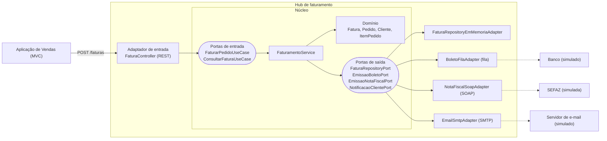

# Aula 7 – Hub de integrações (arquitetura hexagonal)

Projeto `hub` (Spring Boot, porta **8081**) que fatura um pedido. O núcleo (domínio + aplicação) não depende do Spring nem de nenhuma tecnologia de integração: ele só conhece as **portas**. Os **adaptadores** ficam nas bordas.



## Requisitos

| Requisito | Onde está |
|---|---|
| **RF01** Ao receber um pedido, cria e persiste a fatura e devolve o ID à camada REST | `FaturamentoService.faturar` → `FaturaRepositoryPort` → `FaturaController` responde `201 {"faturaId": "..."}` |
| **RF02** Emite o boleto por fila. Restrição: o código de barras é guardado na fatura | `EmissaoBoletoPort` / `BoletoFilaAdapter` (fila `boleto.emitir` em memória, código FEBRABAN de 44 dígitos) → `Fatura.registrarBoleto` |
| **RF03** Emite a nota fiscal por SOAP. Restrição: chave de acesso de 44 dígitos guardada na fatura | `EmissaoNotaFiscalPort` / `NotaFiscalSoapAdapter` (envelope SOAP + resposta simulada com `chNFe`) → `Fatura.registrarNotaFiscal` |
| **RF04** Notifica o cliente por e-mail via SMTP. Restrição: hash do conteúdo guardado na fatura | `NotificacaoClientePort` / `EmailSmtpAdapter` (diálogo SMTP no log, hash SHA-256) → `Fatura.registrarEmail` |

As restrições são validadas na entidade `Fatura`: ela rejeita código de barras ou chave que não tenham 44 dígitos e hash que não seja SHA-256. Ela só fica `FATURADA` quando tem os três comprovantes.

Como pede a observação da atividade, as portas de saída têm **adaptadores simulados**. Para trocar por um real (RabbitMQ, web service da SEFAZ, servidor SMTP, banco JPA), basta criar outra classe que implemente a mesma porta e trocar o `@Bean` em `HubConfiguration`, sem mexer no núcleo.

## Estrutura

```
hub/src/main/java/br/com/hub
├── domain
│   ├── model        Fatura, Pedido, Cliente, ItemPedido, StatusFatura
│   └── exception    RegraFaturamentoException, FaturaNaoEncontradaException
├── application
│   ├── port/in      FaturarPedidoUseCase, ConsultarFaturaUseCase
│   ├── port/out     FaturaRepositoryPort, EmissaoBoletoPort, EmissaoNotaFiscalPort, NotificacaoClientePort
│   └── service      FaturamentoService
├── adapter
│   ├── in/rest      FaturaController, DTOs, TratadorDeErros
│   └── out          persistence, boleto (fila), notafiscal (SOAP), email (SMTP)
└── config           HubConfiguration (liga portas e adaptadores)
```

## Como executar

```bash
cd hub
./gradlew bootRun      # Windows: gradlew.bat bootRun
./gradlew test
```

Exemplo de chamada:

```bash
curl -X POST http://localhost:8081/faturas -H "Content-Type: application/json" -d '{
  "pedidoId": "1",
  "cliente": { "nome": "Maria", "email": "maria@email.com", "documento": "12345678909" },
  "itens": [ { "descricao": "Caneca", "quantidade": 2, "valorUnitario": 29.90 } ]
}'
# 201 Created -> {"faturaId":"6c55ae48-..."}

curl http://localhost:8081/faturas/{faturaId}
```
