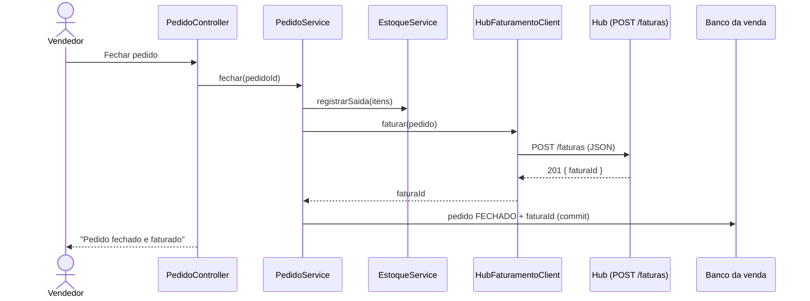
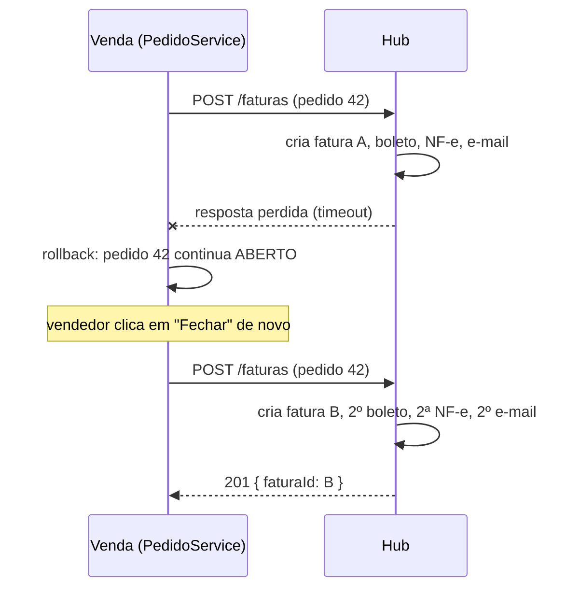

# Análise da integração Venda (MVC) → Hub de faturamento (hexagonal)

## Como a integração foi implementada

Ao clicar em **Fechar pedido e faturar**, o `PedidoService.fechar` faz, dentro de uma única transação do banco da aplicação de vendas:

1. Dá baixa no estoque de cada item com as regras da aula 6. Se algum produto zerar, ele fica INDISPONÍVEL.
2. Chama o hub via REST, com um `POST http://localhost:8081/faturas` feito pelo `HubFaturamentoClient` (`RestClient`, timeout de conexão de 2 s e de leitura de 5 s).
3. Guarda o `faturaId` devolvido no pedido e muda o status para **FECHADO**.

Se o hub responder com erro ou não responder, a transação faz rollback: a baixa de estoque é desfeita, o pedido continua **ABERTO** e o vendedor vê a mensagem de erro.

Essa é uma chamada **síncrona** entre dois sistemas. As duas transações (a da venda e a do hub) são independentes, e é daí que vêm os problemas abaixo.

---

## Problema 1: o hub está fora do ar ou lento

### O que acontece
O vendedor fecha o pedido e o hub não responde: o serviço caiu, está em deploy ou está lento porque a emissão de nota por SOAP demorou.

- **Hub fora do ar:** a conexão é recusada, o `HubFaturamentoClient` lança `IntegracaoHubException` e a transação faz rollback.
- **Hub lento:** a requisição fica presa até estourar o timeout de 5 s. Com muitos vendedores ao mesmo tempo, cada requisição segura uma thread do servidor da venda. Sem timeout, a aplicação de vendas inteira poderia travar, e a falha do hub se espalharia para a venda (falha em cascata).

### O que acontece com o pedido
O pedido continua **ABERTO**, sem `faturaId`, e o estoque volta ao saldo anterior. Nada é perdido, mas a venda **não é concluída**.

### O que o negócio percebe
- O vendedor não consegue fechar nenhuma venda enquanto o hub estiver com problema, mesmo que o cliente esteja ao telefone pronto para comprar.
- A tela demora ou mostra erro, o vendedor tenta de novo várias vezes e a carga sobre o hub aumenta.
- O que é só um problema no **faturamento** vira uma **parada de vendas**: o sistema de vendas fica tão disponível quanto o hub.

### Solução: comunicação assíncrona por fila (mensageria / Pub-Sub), com Circuit Breaker como apoio

**Onde atua:** entre a aplicação de vendas e o hub, no lugar da chamada REST síncrona do `PedidoService`.

- Ao fechar o pedido, a venda grava o pedido como **FECHADO / AGUARDANDO_FATURAMENTO** e publica um evento `PedidoFechado` em uma fila (ex.: RabbitMQ). Para não perder o evento se a venda cair entre o commit e a publicação, o evento é gravado numa tabela *outbox* na mesma transação do pedido e depois publicado.
- O hub consome a fila no seu ritmo, fatura e publica `PedidoFaturado { pedidoId, faturaId }`. A venda consome esse evento e guarda o `faturaId`.
- Se o hub estiver fora do ar, as mensagens **ficam na fila** e são processadas quando ele voltar.

**Por que resolve:** a venda deixa de depender da disponibilidade do hub naquele instante (desacoplamento temporal, como no estilo Publicador/Assinante da aula 3). O vendedor fecha a venda normalmente e o faturamento acontece logo depois.

**Apoio, se a chamada continuar síncrona:** um **Circuit Breaker** (ex.: Resilience4j) no `HubFaturamentoClient`. Depois de algumas falhas seguidas o circuito abre e as próximas chamadas falham na hora, sem esperar o timeout. Isso protege as threads da venda e alivia o hub até ele se recuperar.

---

## Problema 2: o hub fatura, mas a resposta se perde (faturamento duplicado)

### O que acontece
O hub recebe o pedido, cria a fatura, emite o boleto, emite a NF-e e envia o e-mail. Mas a resposta `201 { faturaId }` não chega à venda: o timeout de leitura de 5 s estoura porque o SOAP demorou, a rede cai no meio ou a venda reinicia.

Do lado da venda isso parece uma falha comum. A transação faz rollback e o pedido volta a ficar **ABERTO**, sem `faturaId`. Do lado do hub, a fatura **já existe e já foi processada**.

### O que acontece com o pedido
- A venda guarda só a fatura **B**. A fatura **A** fica órfã no hub, sem nenhum pedido apontando para ela.
- Existem **duas faturas, dois boletos e duas notas fiscais** para o mesmo pedido 42.

### O que o negócio percebe
- O **cliente** recebe dois e-mails e dois boletos. Ele pode pagar duas vezes, o que gera estorno, ou desconfiar da empresa.
- O **fiscal/contábil** tem uma NF-e emitida a mais, que precisa ser cancelada dentro do prazo legal. Senão o imposto é recolhido sobre uma venda que não existiu.
- O **financeiro** tem um título a receber que nunca será pago e precisa ser conciliado à mão.

O problema fica pior se a venda passar a fazer *retry* automático sem nenhuma proteção.

### Solução: idempotência no hub (chave de idempotência = `pedidoId`)

**Onde atua:** no hub, no núcleo da arquitetura hexagonal (`FaturamentoService.faturar`) e na porta de persistência (`FaturaRepositoryPort.buscarPorPedidoId`). A venda envia o `pedidoId` como chave de idempotência, no corpo ou no cabeçalho `Idempotency-Key`.

- Antes de criar a fatura, o hub verifica se já existe uma fatura para aquele `pedidoId`.
  - Se **existe**, devolve o **mesmo `faturaId`** e não emite boleto, nota nem e-mail de novo.
  - Se **não existe**, segue o fluxo normal (RF01 a RF04).
- No banco do hub, uma restrição `UNIQUE (pedido_id)` garante a regra mesmo com duas requisições simultâneas.

**Por que resolve:** repetir a chamada passa a ser seguro. Seja o vendedor clicando de novo, seja um *retry* automático ou a reentrega de uma mensagem da fila do problema 1, o resultado é sempre **uma única fatura por pedido**, e a venda recebe o ID certo para guardar. Por isso a idempotência é também o que permite usar *retry* e filas (que entregam "pelo menos uma vez") sem duplicar faturamento.

---

## Resumo

| | Problema 1: hub indisponível ou lento | Problema 2: resposta perdida |
|---|---|---|
| **Causa** | Dependência síncrona da disponibilidade do hub | Transações separadas; o hub concluiu, mas a venda não soube |
| **Pedido** | Continua ABERTO e o estoque é devolvido | Continua ABERTO, mas o hub já faturou; ao repetir, duplica |
| **Negócio percebe** | Vendas paradas, telas lentas e erros | Cliente com 2 boletos/e-mails, NF-e a cancelar, financeiro inconsistente |
| **Solução** | Fila/mensageria (+ outbox) e Circuit Breaker | Idempotência por `pedidoId` no hub |
| **Onde atua** | Entre a venda e o hub (`PedidoService` / `HubFaturamentoClient`) | No núcleo do hub (`FaturamentoService`) e na sua persistência |
